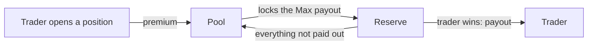

# Earn by backing trades

Deposit USDG into a market's pool and you become the other side of every trade in that market. Traders pay up front. The pool keeps what they pay and pays the ones who win. What is left is the depositors' return.

## How the pool works

In options terms, the pool **writes** every option a trader buys. When a trader picks a direction, amount, term, and leverage, the pool prices that trade and takes the other side itself.

1. **A trader opens a position.** Their premium goes into the pool.
2. **The pool sets aside the Max payout.** It moves enough of its free USDG into reserve to pay that position at any settlement price. That money stays locked until the position settles.
3. **The position settles.** If the trader wins, they are paid from the reserve and the rest is freed. If they lose, the whole reserve is freed and the pool keeps the premium.

Every position has a capped payout, so the pool knows the most it can owe and never promises more than it holds.

## How the pool prices a trade

The pool prices every position as an option, using the **Black-Scholes** model. The contract measures how much the market has been moving from the Chainlink price on chain, then prices with a margin above that. Targets far from today's price carry a larger margin. Nobody sets these prices by hand, and the inputs update as the market moves.

Every possible target sits on a fixed grid of about 16,000 prices, and the pool can quote any of them. A trader never picks a target. They pick a leverage, and the contract matches them to the target closest to today's price that their amount can buy at that leverage.

The trader pays that price plus a 3% trading fee, and a small extra charge when much of the pool is already backing open trades. Over many trades, the margin in the price is the pool's return. [How the yield works](./yield.mdx) covers what that means for the share price.

## One USDG pool per market

Each market has one pool. You deposit **USDG**, the pool backs every long and every short in that market, and it pays winners in USDG. Markets never share a pool, so the Bitcoin pool backs Bitcoin trades and nothing else.

Because one pool backs both directions, a long and a short settling at the same hour can partly offset each other. The pool sets aside the most it could owe at that hour, which is often less than the two maximum payouts added together.

## What you receive

A deposit gives you **shares** in the pool. Your balance is your shares times the share price.

The share price rises as the pool earns premium and falls when traders win. It does not depend on which trades were open when you joined, because you do not back individual trades. You own a slice of everything.

## Requests, not instant deposits

Deposits and withdrawals are **requests** that fill **once an hour**:

1. You request a deposit or a withdrawal.
2. At the end of the hour the pool sets its share price, and every request sent at least 10 minutes before fills at it.
3. After the fill you claim your shares or your USDG.

[Deposits and withdrawals](./deposits-and-withdrawals.mdx) walks through each step, the cutoff, and what happens when a withdrawal can only fill in part.

## What the pool page shows

| Figure         | Meaning                                                                                        |
| -------------- | ---------------------------------------------------------------------------------------------- |
| Total deposits | Everything the pool holds for depositors, including the capital backing open trades            |
| Utilisation    | How much of the pool is backing open trades, and the cap. New trades are refused above the cap |
| Share price    | What one pool share was worth at the last hourly fill. Marked **Estimate** until your own fill |
| 30d APY        | What a pool share earned over the last 30 days, as a yearly rate. Not a promise                |

**Earned by depositors**, **Total deposits** and **Utilisation** chart the pool's history from its hourly fills.

Further down, **Capital breakdown** shows how much of the pool is backing trades right now and how much is free. **Longs and shorts** shows what each side could still be owed, and what each has paid in and been paid since the market opened. **Trades** lists every trade against the pool, newest first, with what the pool made or lost on each one once it settles.

## Your position

| Line               | Meaning                                                                                                                                                                                    |
| ------------------ | ------------------------------------------------------------------------------------------------------------------------------------------------------------------------------------------ |
| Your balance       | What your shares are worth in USDG at the last fill's share price, with the share count under it                                                                                           |
| Earned             | What the pool has made or lost you on what you have in it now: your shares at the current share price, less what you paid for them. It starts again from zero once you withdraw everything |
| Pending deposit    | A deposit request waiting for its fill, with the time left. You can cancel it until its cutoff                                                                                             |
| Pending withdrawal | A withdrawal request waiting for its fill, with the time left. You can cancel it until its cutoff                                                                                          |
| Ready to claim     | Shares from a filled deposit, USDG from a filled withdrawal, or shares returned unfilled                                                                                                   |

**Deposit** and **Withdraw** at the bottom of the card open the ticket.

## Is this for you

A pool is the right place for money you can leave alone for a while and are comfortable putting at risk. It is not a savings account. Winning traders are paid from it, and a run of them lowers the share price. [Pool risks](./risks.mdx) says what can go wrong. [How the yield works](./yield.mdx) says where the return comes from.

Ready to deposit? [Make your first deposit](./quickstart.mdx) walks through it step by step.
